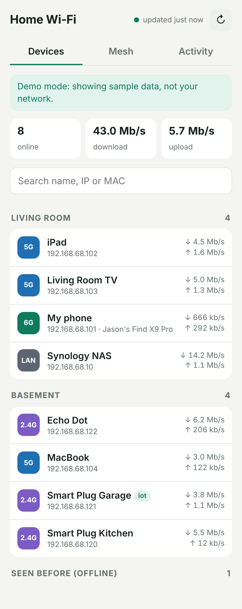

# Deco XE75 Pro dashboard

A small web dashboard for a TP-Link Deco mesh, meant to run in Docker on a Synology NAS
and be opened from any browser (including a phone) on the home network.

**Shows:** every connected device grouped by which Deco it's on, with IP, band (2.4/5/6 GHz or
wired), network (main/guest/IoT) and live speed · each Deco station's IP, backhaul, signal and
firmware · public IP, DNS, CPU and memory of the main unit · 24-hour charts of devices online
and total download.

**Manufacturer guess** for every device from its MAC address (IEEE registry via Wireshark's list),
with private/random phone addresses flagged.

**Beta tab:** estimated data used per device today and per day for the last week, a 24-hour
"who's been online" timeline, device makers online now, a log of devices switching Deco or band,
and a network log (public IP changes, internet drops, mesh link changes, dashboard losing contact).

**Controls:** turn main or guest Wi-Fi on/off per band · reboot the mesh.

**Adds what the Deco app lacks:** a history of every device ever seen (first/last seen),
nicknames and notes per device, new-device alerts (on the page, and optionally to your phone
via [ntfy](https://ntfy.sh)), and an online/offline event log.

It talks to the Deco's local API using the open-source
[tplinkrouterc6u](https://github.com/AlexandrErohin/TP-Link-Archer-C6U) library, which lists the
Deco XE75 Pro as supported. Nothing goes through TP-Link's cloud.

## Install on Synology (from a phone browser)

1. **Make the image public (one time).** On GitHub, open your profile → **Packages** →
   `decox75pro` → **Package settings** → **Change visibility** → Public. The image contains no
   passwords; those live only on your NAS.
2. **Open DSM** in the browser while on home Wi-Fi: `http://<NAS-IP>:5000`.
3. **Container Manager → Project → Create.**
   - Project name: `deco-dashboard`
   - Path: create a folder, e.g. `/docker/deco-dashboard`, and inside it (in File Station)
     create an empty folder named `data`. Synology won't create it for you.
   - Source: *Create docker-compose.yml*, and paste the contents of
     [`docker-compose.yml`](docker-compose.yml).
   - Change `DECO_PASSWORD` (and `DECO_HOST` if your main Deco isn't `192.168.68.1`).
4. Tap **Next → Done**. When it's running, open `http://<NAS-IP>:18473`.

The first reading treats every device already on your network as known, so you only get
"new device" alerts for devices that join after that.

### Updating

When the code changes, GitHub rebuilds the image automatically. In Container Manager:
**Project → deco-dashboard → Action → Build**. The compose file has `pull_policy: always`, so
Build fetches the newest image. (If your compose file predates that line, add it under `image:`.)

## Settings (environment variables)

| Variable | Default | Meaning |
|---|---|---|
| `DECO_HOST` | `http://192.168.68.1` | Main Deco's address. Try `https://…` if `http` fails. |
| `DECO_PASSWORD` | — | Password of the TP-Link ID that owns the Deco network. |
| `DASH_PASSWORD` | empty | If set, the dashboard asks for this password (any username). Recommended, since the page can reboot the mesh. |
| `NTFY_URL` | empty | e.g. `https://ntfy.sh/a-long-secret-name`. Install the ntfy app on your phone and subscribe to the same name to get push alerts. |
| `POLL_SECONDS` | `60` | How often to read the Deco (minimum 20). |
| `OFFLINE_AFTER_POLLS` | `3` | Missed readings before a device counts as "went offline". |
| `DEMO` | `0` | `1` shows fake data, for trying the page without a Deco. |

## Good to know

- The Deco allows **one local login at a time**. The dashboard logs in and out on every
  reading, but if you're using `tplinkdeco.net` in a browser at the same moment, one of them may
  get logged out. The phone app is not affected.
- If the page shows "Can't read the Deco", check the password and host first. Then look at
  `http://<NAS-IP>:18473/api/raw` (raw Deco responses, Wi-Fi passwords removed) and the container
  log in Container Manager.
- Device history is kept in `data/deco.db` in the project folder. Speed samples are kept 30 days,
  events 180 days.
